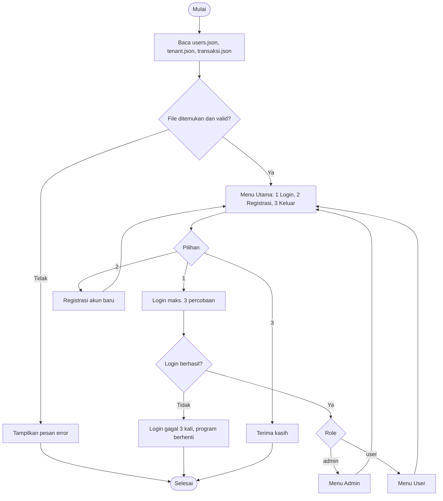
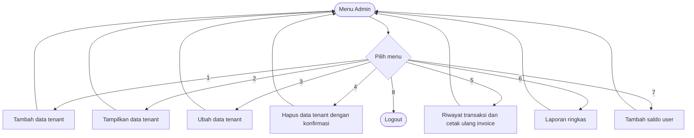
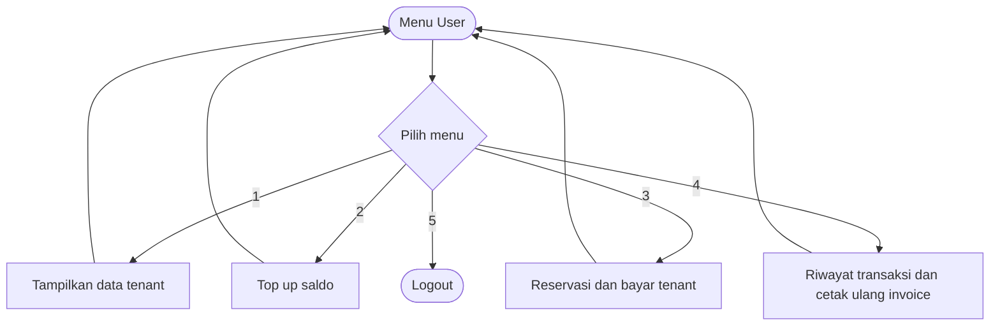
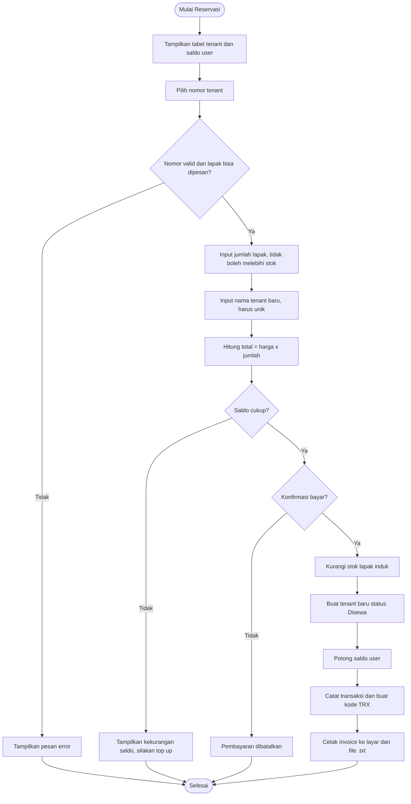

<div align="center">

# 🏪 Sistem Reservasi Tenant Bazar

**Aplikasi berbasis terminal (CLI) untuk mengelola lapak bazar, saldo e-money, reservasi, dan invoice.**


</div>

---

## 📑 Daftar Isi

1. [Judul / Tema](#1--judul--tema)
2. [Anggota & Peran](#2--anggota--peran)
3. [Deskripsi & Tujuan](#3--deskripsi--tujuan)
4. [Flowchart](#4--flowchart)
5. [Daftar Fitur per Role](#5--daftar-fitur-per-role)
6. [Screenshot Output & Penjelasan](#6--screenshot-output--penjelasan)
7. [Cara Menjalankan Program](#7--cara-menjalankan-program)

---

## 1. 🎯 Judul / Tema

| | |
|---|---|
| **Judul** | Sistem Reservasi Tenant Bazar |
| **Tema** | Manajemen penyewaan lapak bazar dengan pembayaran e-money |
| **Bahasa** | Python (CLI / terminal) |
| **Penyimpanan data** | File JSON (`users.json`, `tenant.json`, `transaksi.json`) |

---

## 2. 👥 Anggota & Peran

| No | Nama | NIM / ID | Peran | Tanggung Jawab | GitHub |
|:--:|------|----------|-------|----------------|--------|
| 1 | **Muhammad Pasha Aditya** | `2609116085` | Ketua Tim | Autentikasi (login & registrasi), Erorr Handling, Membantu CRUD dasar, Membantu revisi Flowchart dan Laporan | [@MuhammadPashaAditya](https://github.com/MuhammadPashaAditya) |
| 2 | **Lithalia Geminifer Addawiyah** | `2609116088` | Pengembang Tenant | CRUD data tenant (tambah, tampil, ubah, hapus), menu admin | [@username2](https://github.com/username2) |
| 3 | **Muhammad Fahry Praditya** | `2609116104` | Pengembang Transaksi | Top up, reservasi & pembayaran, invoice, menu user | [@username3](https://github.com/username3) |
| 4 | **Astri Maharani** | `2609116106` | Dokumentasi & Pengujian | Riwayat transaksi, laporan admin, README, pengujian program | [@username4](https://github.com/username4) |

---

## 3. 📖 Deskripsi & Tujuan

### Deskripsi

**Sistem Reservasi Tenant Bazar** adalah program Python berbasis terminal yang membantu pengelolaan penyewaan lapak pada sebuah bazar. Program memiliki dua peran pengguna, yaitu **Admin** yang mengelola lapak dan memantau transaksi, serta **User** yang menyewa lapak dengan membayar memakai saldo e-money.

Setiap lapak induk memiliki kuota maksimal **20 lapak** dan dibagi ke dalam 5 kategori: Makanan, Minuman, Fashion, Kerajinan, dan Lainnya. Ketika user menyewa, kuota lapak induk berkurang dan tenant baru milik penyewa muncul di bawah lapak induknya dengan status **Disewa**. Setiap pembayaran menghasilkan kode transaksi unik dan invoice `.txt`.

### Tujuan

1. Memudahkan admin mengelola data lapak, stok, dan harga sewa secara terpusat.
2. Memudahkan user melakukan reservasi dan pembayaran lapak tanpa pencatatan manual.
3. Menyediakan pencatatan transaksi dan invoice yang rapi serta dapat dicetak ulang.
4. Memberikan laporan ringkas pendapatan dan tenant terlaris untuk admin.
5. Menerapkan konsep dasar pemrograman Python: fungsi, struktur data, percabangan, perulangan, penanganan error, dan file JSON.

---

## 4. 🔀 Flowchart

> Flowchart di bawah ditulis dengan Mermaid, sehingga tampil otomatis di GitHub.

### 4.1 Alur Program Utama



### 4.2 Alur Menu Admin



### 4.3 Alur Menu User



### 4.4 Alur Reservasi & Pembayaran



---

## 5. 📋 Daftar Fitur per Role

### 🌐 Umum (Tanpa Login)

| Fitur | Keterangan |
|-------|------------|
| Login | Maksimal 3 kali percobaan, password tersembunyi saat diketik |
| Registrasi | Username unik, tidak boleh kosong, tidak boleh mengandung spasi; akun baru otomatis berperan `user` dengan saldo Rp 0 |
| Keluar | Menutup program |

### 👑 Admin

| No | Fitur | Keterangan |
|:--:|-------|------------|
| 1 | Tambah data tenant | Input nama, kategori, dan harga sewa; lapak baru otomatis berkuota 20 |
| 2 | Tampilkan data tenant | Tabel terurut per kategori, lapak induk diikuti tenant hasil sewa |
| 3 | Ubah data tenant | Ubah nama, kategori, harga, dan stok; tenant hasil sewa hanya bisa diubah namanya |
| 4 | Hapus data tenant | Dengan konfirmasi y/n; menghapus lapak induk ikut menghapus tenant hasil sewanya |
| 5 | Riwayat transaksi & cetak ulang invoice | Melihat transaksi seluruh user |
| 6 | Laporan ringkas | Total pendapatan, jumlah transaksi reservasi, tenant terlaris |
| 7 | Tambah saldo user | Admin menambah saldo user (Rp 10.000 sampai Rp 10.000.000) |
| 8 | Logout | Kembali ke menu utama |

### 👤 User

| No | Fitur | Keterangan |
|:--:|-------|------------|
| 1 | Tampilkan data tenant | Melihat daftar lapak, stok, dan status |
| 2 | Top up saldo | Minimal Rp 10.000, maksimal Rp 10.000.000 per transaksi, dengan konfirmasi |
| 3 | Reservasi & bayar tenant | Memilih lapak, jumlah, nama tenant, lalu bayar dengan saldo |
| 4 | Riwayat transaksi & cetak ulang invoice | Hanya transaksi milik sendiri |
| 5 | Logout | Kembali ke menu utama |

---

## 6. 📸 Screenshot Output & Penjelasan

> 📝 **Petunjuk untuk tim:** jalankan program, ambil screenshot tiap tampilan, simpan di folder `docs/screenshots/` dengan nama file seperti di bawah, lalu gambar akan muncul otomatis.

### 6.1 Menu Utama


**Penjelasan:** Tampilan awal program dengan tiga pilihan: Login, Registrasi, dan Keluar. Input selain 1 sampai 3 menampilkan pesan "Pilihan tidak valid".

### 6.2 Registrasi


**Penjelasan:** User mengisi username dan password. Program memeriksa username kosong, mengandung spasi, atau sudah dipakai. Jika valid, akun tersimpan ke `users.json` dengan role `user` dan saldo Rp 0.

### 6.3 Login


**Penjelasan:** Password tampil sebagai karakter bintang. Jika salah, program menampilkan sisa percobaan. Setelah 3 kali gagal, program berhenti.

### 6.4 Menu Admin


**Penjelasan:** Admin melihat 8 menu: kelola tenant, riwayat, laporan, tambah saldo user, dan logout.

### 6.5 Tampilkan Data Tenant


**Penjelasan:** Data tampil dalam tabel dengan kolom No, Nama Tenant, Kategori, Harga Sewa, Stok, Status, dan Penyewa. Lapak induk berstatus `Tersedia` atau `Penuh`, sedangkan tenant hasil sewa berstatus `Disewa` dan tampil di bawah lapak induknya.

### 6.6 Tambah Data Tenant


**Penjelasan:** Admin mengisi nama, memilih kategori (1 sampai 5), dan menentukan harga sewa. Nama yang kosong atau sudah ada akan ditolak. Lapak baru otomatis memiliki stok 20.

### 6.7 Ubah Data Tenant


**Penjelasan:** Admin memilih tenant berdasarkan nomor di tabel, lalu mengubah data. Stok tidak boleh melebihi 20.

### 6.8 Hapus Data Tenant


**Penjelasan:** Program meminta konfirmasi (y/n) sebelum menghapus. Jika yang dihapus adalah lapak induk, tenant hasil sewanya ikut terhapus dan muncul peringatan lebih dulu.

### 6.9 Laporan Ringkas


**Penjelasan:** Menampilkan total pendapatan, jumlah transaksi reservasi, tenant terlaris, dan tabel jumlah lapak yang dipesan per tenant.

### 6.10 Tambah Saldo User (Admin)


**Penjelasan:** Admin melihat daftar user beserta saldonya, memilih username tujuan, lalu mengisi nominal. Transaksi tercatat sebagai "Top Up Admin".

### 6.11 Menu User


**Penjelasan:** User melihat 5 menu: lihat tenant, top up, reservasi, riwayat, dan logout.

### 6.12 Top Up Saldo


**Penjelasan:** Program menampilkan saldo saat ini dan batas top up. Nominal di luar batas ditolak. Setelah dikonfirmasi, saldo bertambah dan kode transaksi ditampilkan.

### 6.13 Reservasi & Pembayaran


**Penjelasan:** User memilih lapak, jumlah, dan nama tenant, lalu program menampilkan ringkasan dan total bayar. Jika saldo kurang, ditampilkan selisihnya. Jika cukup dan dikonfirmasi, stok berkurang dan saldo terpotong.

### 6.14 Invoice


**Penjelasan:** Setelah pembayaran berhasil, invoice tampil di layar dan tersimpan sebagai file `.txt` di folder `invoice`. Isinya kode transaksi, waktu, pelanggan, tenant, kategori, jumlah lapak, total bayar, dan sisa saldo.

### 6.15 Riwayat Transaksi


**Penjelasan:** Tabel berisi kode, waktu, user, tipe, tenant, nama usaha, qty, jumlah, dan saldo akhir. User hanya melihat transaksinya sendiri, admin melihat semua. Invoice reservasi dapat dicetak ulang dengan memasukkan kode transaksi.

---

## 7. 🚀 Cara Menjalankan Program

```bash
# 1. Clone repositori
git clone https://github.com/<nama-organisasi>/<nama-repositori>.git
cd <nama-repositori>

# 2. Pasang library
pip install prettytable pwinput

# 3. Jalankan
python main.py
```

Program membaca data dari folder `C:\ApasProjek`. Pastikan `users.json` dan `tenant.json` ada di folder tersebut (ubah variabel `folder_data` jika ingin lokasi lain). `transaksi.json` dan folder `invoice` dibuat otomatis.

Contoh `users.json`:

```json
{
    "admin": { "password": "ganti_password_ini", "role": "admin", "saldo": 0 },
    "budi":  { "password": "rahasia123", "role": "user", "saldo": 0 }
}
```

---

<div align="center">

Dibuat oleh **Tim <Nama Organisasi>**

</div>
